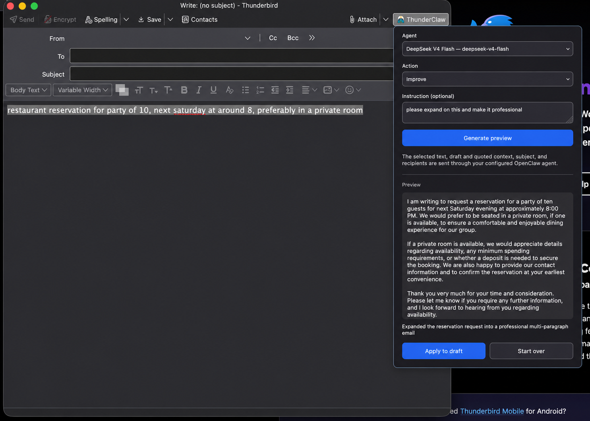
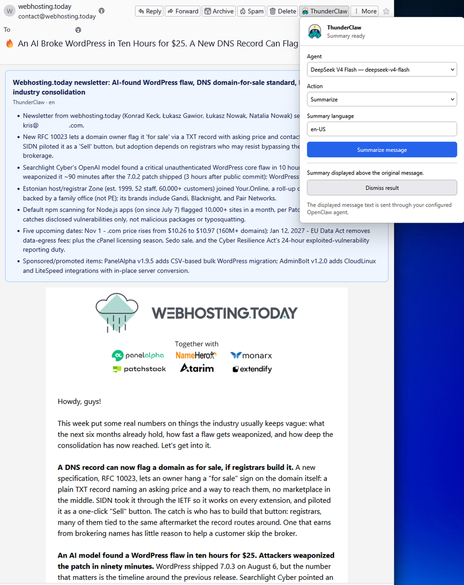
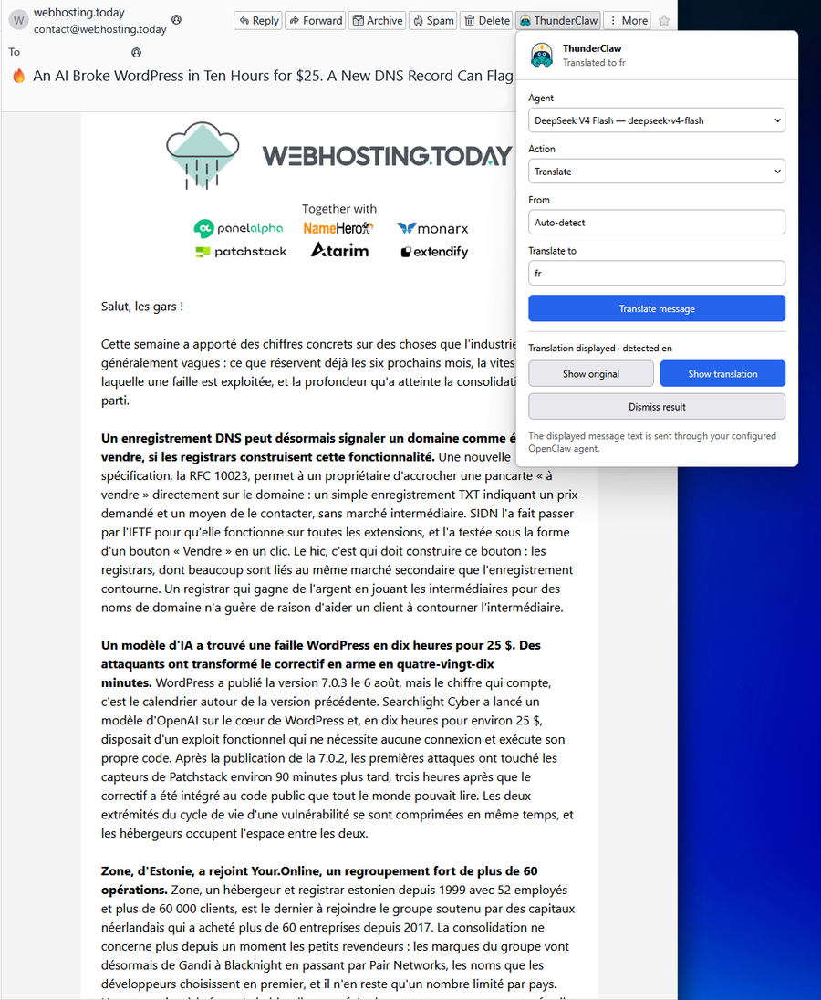

<p align="center">
  
</p>

<h1 align="center">ThunderClaw</h1>

<p align="center">
  <strong>AI writing and reading assistance for Thunderbird, using your chosen provider or local model.</strong>
  <br>
  Your inbox, your decisions, your control.
</p>

<p align="center">
  <a href="https://github.com/kwatson/thunderclaw/actions/workflows/ci.yml"></a>
  <a href="LICENSE"></a>
  <a href="docs/compatibility.md"></a>
  <a href="https://github.com/kwatson/thunderclaw/releases/latest"></a>
</p>

<p align="center">
  <a href="#what-it-can-do">Features</a> ·
  <a href="#how-it-stays-safe">Safety</a> ·
  <a href="docs/installation-and-pairing.md">Installation</a> ·
  <a href="docs/development.md">Development</a> ·
  <a href="CONTRIBUTING.md">Contributing</a>
</p>

> [!NOTE]
> The development branch is migrating to a standalone extension with direct OpenAI-compatible connections, including DeepSeek, OpenRouter, Ollama and LM Studio. Published older releases use OpenClaw. See the [migration status](docs/standalone-migration.md) and [connection setup](docs/installation-and-pairing.md).

## AI assistance without handing over your inbox

ThunderClaw brings useful writing and reading tools into desktop Thunderbird
while keeping Thunderbird—and you—in charge. A model can propose an edit,
summary, or translation. It cannot send mail, silently rewrite a message, or
change recipients, attachments, or headers.

Every compose change follows the same deliberate flow:

**Generate → Preview → Apply → Undo**

The current Thunderbird content remains authoritative throughout. Results are
validated in the background and at the Thunderbird editing boundary, and stale results fail closed.

## See it in action

Preview a writing improvement before choosing whether to apply it to the draft:

<p align="center">
  
</p>

Reading tools keep generated results separate from the original message and
make them easy to dismiss or reverse.

<table>
  <tr>
    <td width="50%" align="center"><strong>Summarize a message</strong></td>
    <td width="50%" align="center"><strong>Translate in place</strong></td>
  </tr>
  <tr>
    <td width="50%"></td>
    <td width="50%"></td>
  </tr>
</table>

## What it can do

| In the composer | In a received message |
| --- | --- |
| Improve, proofread, shorten, or change tone | Create a separate plain-text summary card |
| Translate or summarize selected draft text | Reversibly translate visible message text |
| Follow a custom writing instruction | Preserve the message's original HTML structure |
| Preview before applying and undo afterward | Leave the original message untouched |

Thunderbird 128 and newer support plain selected-text transformations.
Qualified Thunderbird 153 and newer selections can also preserve or produce
narrowly typed rich content: paragraphs, flat lists, and bold, italic, or
underlined spans. Unsupported shapes are rejected rather than guessed at.

See the [product contract](docs/product-contract.md) for exact capability and
eligibility rules.

## Your inference connection

The standalone development extension connects directly to OpenAI, OpenRouter,
DeepSeek, Ollama, LM Studio, or a custom OpenAI-compatible endpoint. Choose the
endpoint and model in settings, provide a key if needed, grant host access,
save, and run the synthetic connection test. Keys are remembered locally across
restarts. They are not synchronized or an encrypted vault.

Compose requests send the selected text and authored draft context, without
recipient addresses or extracted quoted history. Reading requests send eligible
visible message segments. Local state fingerprints still detect changes to
recipients, headers, attachments and the captured text before Apply. Read the
[privacy policy](docs/privacy-policy.md) for details.

A loopback endpoint can itself forward to hosted models. OpenRouter may route
to an upstream provider. ThunderClaw never silently changes your configured
endpoint or model. The project operates no inference or analytics service.

## How it stays safe

- Thunderbird owns DOM changes, validation, rollback, and Undo. Models return
  bounded typed data; model HTML is never inserted.
- Sending remains manual. Models cannot change recipients, headers, or attachments.
- Request/run identity, generations, target/context hashes, connection epochs,
  output limits and exact segment mapping reject stale or misplaced changes.
- The background owns credentials, prompts and transport. Settings and feature
  messages are restricted to their trusted extension pages.
- HTTPS is required remotely; explicit loopback HTTP is supported. Redirects
  and automatic endpoint/model fallback are rejected.

See [architecture](docs/architecture.md) and [migration status](docs/standalone-migration.md).

## Installation

The development candidate is not yet a newly published marketplace release.
Build the extension from this checkout, install its XPI in Thunderbird, and
follow [connection setup](docs/installation-and-pairing.md). No OpenClaw plugin
or ThunderClaw companion service is required for the new extension.

Older published extensions use OpenClaw. Their instructions remain available
at their release tags. Upgrading does not transfer OpenClaw provider keys or
agent memory. Configure your inference connection explicitly and revoke the old
paired device separately.

## Development

ThunderClaw uses Node.js through [`mise`](https://mise.jdx.dev/):

```bash
mise exec -- npm ci
mise exec -- npm test
mise exec -- npm run typecheck
mise exec -- npm run build
```

The monorepo keeps both sides of the boundary reviewable together while
packaging them independently:

```text
packages/openclaw-plugin/         Legacy OpenClaw plugin (migration maintenance)
packages/thunderbird-extension/   Thunderbird extension source and icons
test/                             Unit, contract, lifecycle, and boundary tests
e2e/                              Real Thunderbird and qualification tooling
fixtures/                         Cross-boundary conformance fixtures
scripts/                          Build and qualification entry points
docs/                             Product, protocol, security, and release docs
```

Shared fixtures test conformance, but each component independently validates
the runtime contract across the HTTP boundary. Start with the
[development guide](docs/development.md), [testing guide](docs/testing.md), and
[contribution guide](CONTRIBUTING.md).

## Project status

ThunderClaw `v0.1.0` is the first public release and is available from
[Thunderbird Add-ons](https://addons.thunderbird.net/en-US/thunderbird/addon/thunderclaw/)
and [ClawHub](https://clawhub.ai/thunderclaw/plugins/openclaw-plugin). The
[roadmap](docs/roadmap.md) is the authoritative list of unfinished work and
post-release hardening.

Bug reports, documentation improvements, tests, and focused code changes are
welcome. For substantial behavior, protocol, dependency, or UI changes, please
open an issue before investing in an implementation.

## Documentation

- [Architecture](docs/architecture.md) — component ownership and data flow
- [Product contract](docs/product-contract.md) — supported behavior and review boundaries
- [Compatibility](docs/compatibility.md) — supported runtimes and upgrade policy
- [Security and privacy](docs/security-and-privacy.md) — trust, credentials, disclosure, and residual risks
- [Privacy policy](docs/privacy-policy.md) — ATN-ready data practices and listing disclosure collateral
- [Installation and pairing](docs/installation-and-pairing.md) — installation and operator/user pairing
- [Development](docs/development.md) — development environment and plugin updates
- [Testing](docs/testing.md) — test layers and qualification matrices
- [Release process](docs/release.md) — artifact acceptance and publication policy
- [OpenClaw upgrade runbook](docs/openclaw-upgrade-runbook.md) — compatibility-bump and publication sequence
- [Protocol reference](docs/reference/) — normative boundary contracts
- [Brand](docs/brand/) — assets, specification, licensing, and provenance

## Community and license

Please read [CONTRIBUTING.md](CONTRIBUTING.md) before opening a pull request and
use [SECURITY.md](SECURITY.md) for private vulnerability reports. Community
participation is governed by the [Code of Conduct](CODE_OF_CONDUCT.md).

Code, documentation, and project-owned assets are licensed under the
[Apache License 2.0](LICENSE). The ThunderClaw name, logo, and character are
also covered by the [trademark policy](TRADEMARKS.md).

---

<p align="center">
  <strong>Want safer AI assistance in Thunderbird?</strong><br>
  Star ThunderClaw to follow the journey—and help more Thunderbird users find it. ⚡
</p>
